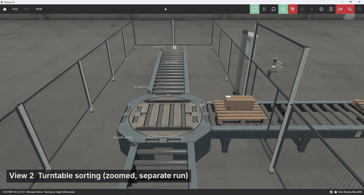
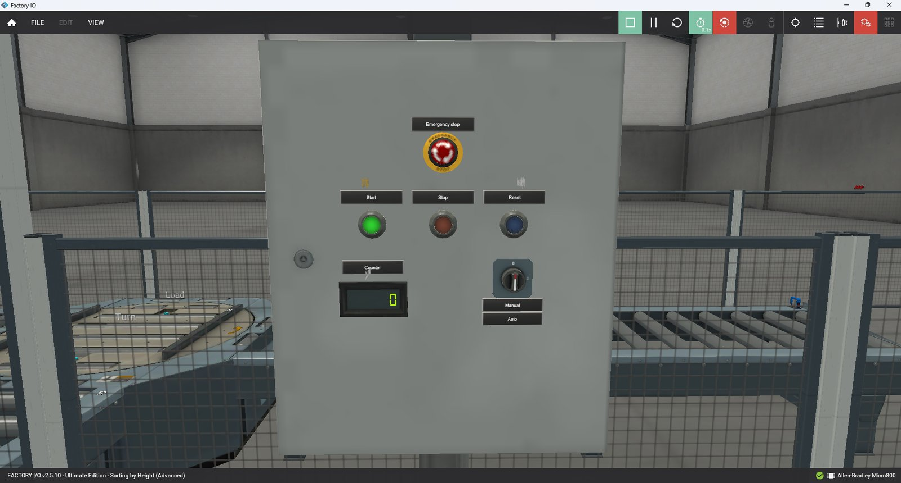
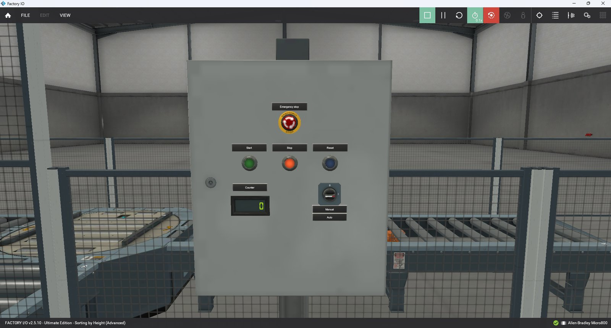
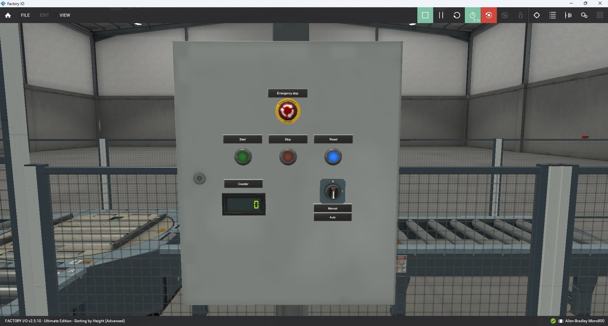
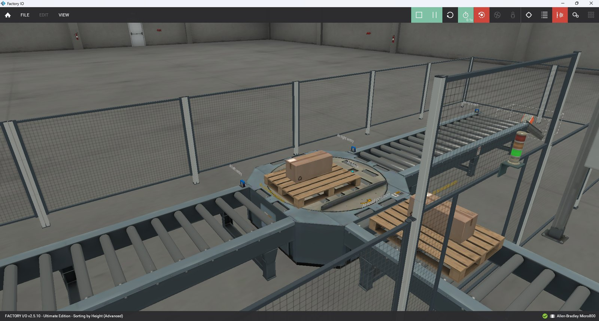
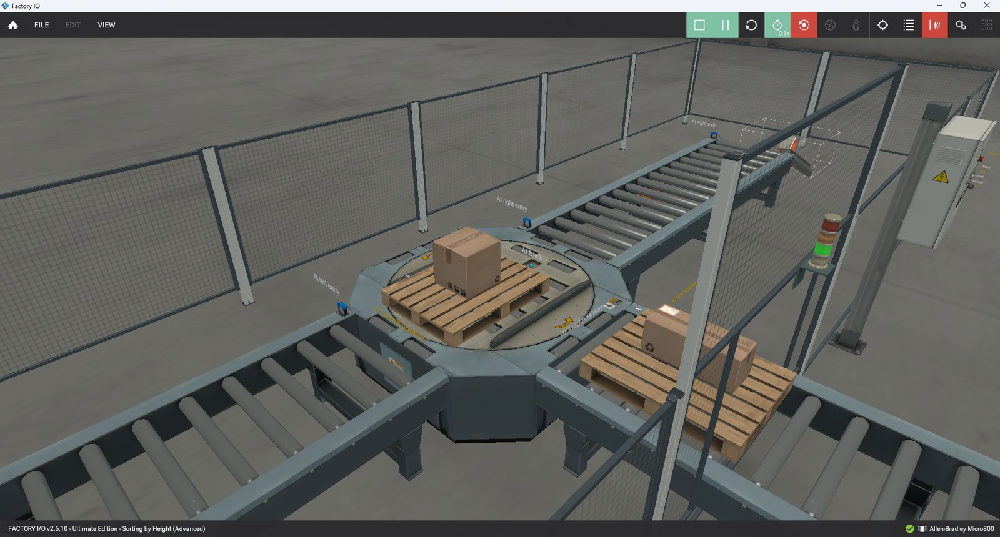
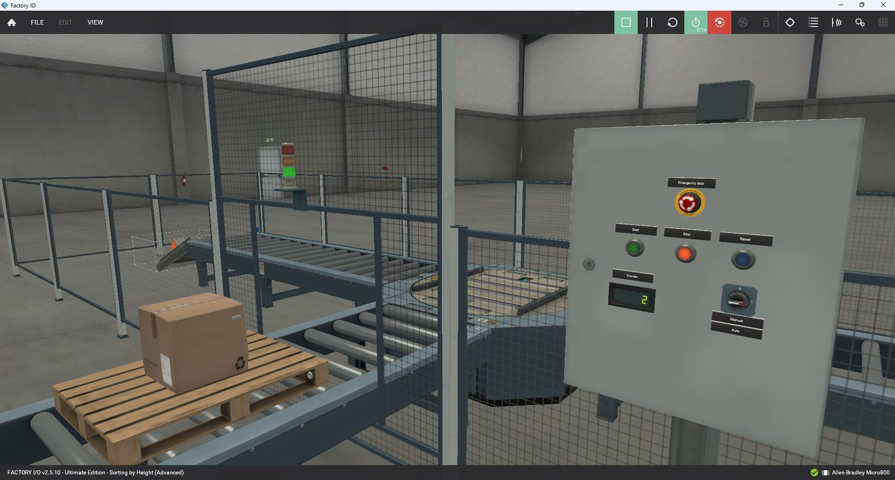
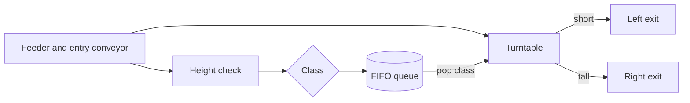
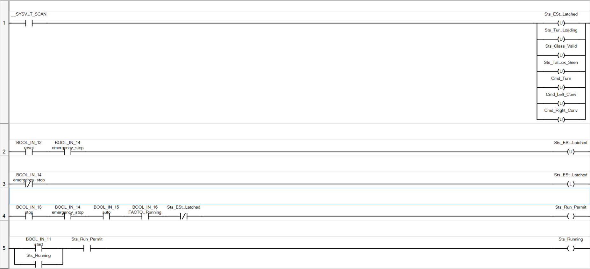

# Sorting by Height: Micro850 PLC Program

A ladder-logic program that sorts boxes by height on a conveyor line with a turntable.
It runs on an Allen-Bradley **Micro850** (Micro800 simulator) and controls the
**Factory I/O** scene *Sorting by Height (Advanced)*. It was written in Connected
Components Workbench (CCW).



> **Demo video:** [media/demo-slow-motion.mp4](media/demo-slow-motion.mp4) (56 s), recorded in Factory I/O slow motion (0.1x).
> It shows the sorting sequence only. The Stop button, the E-stop and the boxes-in-process counter are shown in the [screenshots](#screenshots).

## What it does

* Measures each box with a low and a high beam. A box that blocks both beams is **tall**, otherwise **short**.
* Stores each box's class in a **FIFO queue**, so classification and sorting stay in step even with several boxes on the line.
* Moves the box onto a **turntable**, reads its class from the queue and sends it to the right exit conveyor: **short to the left, tall to the right**.
* Holds the feeder when the queue is full.
* Counts **boxes in process**: +1 at the entry sensor, −1 at either exit sensor. The value is shown on the Factory I/O counter display.
* **Start / Stop / E-stop / Reset / Auto** interlocks, with a latched E-stop and a stack light (green running, yellow stopped, red E-stop).

## Tools

| | |
|---|---|
| Controller | Allen-Bradley Micro850 (Micro800 simulator, no physical PLC) |
| Programming software | Connected Components Workbench 23.0 |
| Language | Ladder diagram |
| Simulation | Factory I/O v2.5.10 (Ultimate Edition), Allen-Bradley Micro800 driver |
| Scene | Sorting by Height (Advanced), lightly modified (see [factory-io](factory-io/README.md)) |

## Screenshots

| Start required | Running | E-stop |
|---|---|---|
|  |  |  |

| Short box | Tall box | Boxes in process |
|---|---|---|
|  |  |  |

More in [`media/images/simulation`](media/images/simulation/): scene overview, stack lights, E-stop pressed.

## How it works

The program is one ladder routine of 45 rungs, in a fixed scan order.



| Rungs | Section |
|---|---|
| R01 – R05 | First scan, E-stop latch, run permissive, Start seal-in |
| R06 – R12 | Height classification, FIFO load |
| R13 – R17 | FIFO read, active class |
| R18 – R25 | Turntable, entry conveyor, feeder |
| R26 – R31 | Exit conveyors |
| R32 – R34 | Boxes-in-process counter |
| R35 – R45 | Outputs, stack light, counter display |

Details: [docs/program-structure.md](docs/program-structure.md). The full logic as readable text:
[docs/ladder-logic.txt](docs/ladder-logic.txt).

### Ladder screenshots

| Rungs | Image |
|---|---|
| R01 – R05 | [r01-r05.png](media/images/ladder/r01-r05.png) |
| R06 – R11 | [r06-r11.png](media/images/ladder/r06-r11.png) |
| R12 – R15 | [r12-r15.png](media/images/ladder/r12-r15.png) |
| R16 – R20 | [r16-r20.png](media/images/ladder/r16-r20.png) |
| R21 – R26 | [r21-r26.png](media/images/ladder/r21-r26.png) |
| R27 – R33 | [r27-r33.png](media/images/ladder/r27-r33.png) |
| R34 – R39 | [r34-r39.png](media/images/ladder/r34-r39.png) |
| R40 – R45 | [r40-r45.png](media/images/ladder/r40-r45.png) |



## Design notes

* **Seal-in run rung.** `Sts_Running` is rebuilt every scan from Start and the run permissive, so losing any condition stops the cell.
* **Commands, then outputs.** Logic sets `Cmd_` bits. The output section at the bottom writes each physical output once and gates every actuator with `Sts_Running`.
* **Named flags.** `Sts_` state, `Cmd_` command, `Pls_` one-scan pulse, `Cnt_` counter, `Class_` height class. Full convention in [docs/variables.md](docs/variables.md).
* **Safe ordering.** Values are produced above the rungs that use them. The E-stop Reset rung sits above the E-stop Set rung, so a pressed E-stop always wins.
* **Stop and E-stop are normally closed**, so a broken wire stops the cell.
* **Raw I/O names cannot change.** The Factory I/O driver generates `BOOL_IN_x` and `BOOL_OUT_x`, so the meaning is in the CCW Alias column and in [docs/io-table.md](docs/io-table.md).

## Run it yourself

1. Install CCW and Factory I/O (this project was run on the Ultimate Edition, v2.5.10).
2. Open [`ccw-project/sorting_boxes_advance/sorting_boxes_advance.ccwsln`](ccw-project/) in CCW.
3. Start the Micro800 Simulator, then build and download the program.
4. Open the scene in [`factory-io/`](factory-io/), choose the **Allen-Bradley Micro800** driver and connect it to the simulator.
5. Run the scene, select **Auto** and press **Start** on the control panel.

More in [ccw-project/README.md](ccw-project/README.md) and [factory-io/README.md](factory-io/README.md).

## Repository layout

```
.
├── README.md
├── LICENSE
├── ccw-project/        CCW solution (open the .ccwsln)
├── factory-io/         Factory I/O scene
├── docs/
│   ├── io-table.md            every I/O point and what it does
│   ├── variables.md           variables, types, naming convention
│   ├── ladder-logic.txt       all 45 rungs as readable text
│   ├── program-structure.md   scan order, sequence, design choices
│   └── simulation-evidence.md simulation screenshots by behaviour
└── media/              demo video, GIF, screenshots
```

## Limitations

* Tested only on the Micro800 simulator with Factory I/O, not on a physical Micro850.
  On the development laptop the simulator-to-Factory I/O link responded slowly. This was not investigated further.
* The turntable handles one box at a time. The queue (10 slots) buffers measured boxes only.
* No Manual mode, no alarms or timeouts, no user-defined function blocks.
* The demo video was recorded in slow motion and shows the sorting sequence only.

## Possible extensions

* Manual mode with jog buttons.
* Jam and timeout alarms on the turntable and exit conveyors.
* A throughput counter (boxes per hour, per class).
* Move the sequence into a user-defined function block.

## License

[MIT](LICENSE). Factory I/O, Connected Components Workbench and Micro800 are trademarks of their respective owners.
