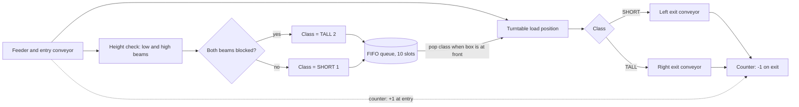

# Program structure

One ladder program, `Sort_By_Height`, with 45 rungs, running in `MainTask`.
The rungs are grouped by purpose, and the order is deliberate: the PLC scans
top to bottom, so a value is always produced above the rungs that use it.

```
Controller Micro850
└── Tasks
    └── MainTask
        └── Program1
            └── Sort_By_Height   (ladder, 45 rungs)
```

## Scan order

| Rungs | Section | What it does |
|---|---|---|
| R01 | First scan | Clears every latched state on program start. |
| R02 – R05 | Safety and run control | E-stop latch/reset, run permissive, Start seal-in. |
| R06 – R12 | Classification and queue load | Detects tall vs short boxes, pushes the class into the FIFO queue. |
| R13 – R17 | Queue read | When a box reaches the turntable front, pops its class and decodes short/tall. |
| R18 – R25 | Turntable and entry | Loading sequence, turntable rollers and turn, entry conveyor, feeder. |
| R26 – R31 | Exit conveyors | Starts the correct exit conveyor, stops it when the box has left. |
| R32 – R34 | Counter | Boxes-in-process up/down counter. |
| R35 – R45 | Outputs | All physical outputs, written once each, at the bottom of the program. |

## Process sequence



1. The feeder puts a box on the entry conveyor. The entry sensor (`BOOL_IN_0`) counts it into the process.
2. The box passes the low and high beams. If it blocks both, it is **tall**, otherwise **short** (R06 – R10).
3. When the box has fully passed the low beam, its class is pushed into a FIFO queue (R11, R12). The feeder stops if the queue is full (R25).
4. The box rides onto the turntable. When it is at the front, the PLC pops the oldest class from the queue (R13 – R15).
5. The turntable turns and unloads the box towards the matching exit: short to the left, tall to the right (R20 – R23, R26, R27).
6. The exit conveyor runs until the box has left it, then stops (R28 – R31). The counter goes down by one (R32, R34).

The queue is what keeps classification and sorting in step: height is measured
upstream, and the class has to wait until its box reaches the turntable.

## Run control

* **Run permissive** (`Sts_Run_Permit`, R04): Stop not pressed, E-stop released,
  Auto selected, Factory I/O running, and no E-stop latch.
* **Start** (R05) seals in `Sts_Running` as long as the permissive stays true.
  Losing any condition drops `Sts_Running`.
* **Every actuator output is gated by `Sts_Running`** (R35 – R41), so one bit stops the whole cell.
* **E-stop** (R02, R03) is latched. Releasing the button is not enough: Reset must be pressed with the E-stop released.
  The Reset rung is above the Set rung, so a pressed E-stop always wins.
* **Stack light** (R42 – R44): green while running, yellow when stopped and ready, red on E-stop. The Start, Stop and Reset button lights follow the same states.

## Design choices

| Choice | Why |
|---|---|
| Seal-in rung (`OTE`) for `Sts_Running` instead of latch/unlatch | The run state is rebuilt every scan from the permissive, so a lost condition cannot leave the cell latched on. |
| `Cmd_` bits, then one output section | Logic decides *what is wanted*; the output section decides *whether it may happen*. One gate (`Sts_Running`) covers every output. |
| Each `BOOL_OUT_x` written in exactly one rung | No double-coil conflicts, and easy to find what drives an output. |
| Edge detection with F_TRIG / R_TRIG, results stored as `Pls_` bits | Each pulse is TRUE for exactly one scan and is reused by several rungs. |
| Dominant action last (Reset above Set for the E-stop) | The last rung to write a bit wins, so the safe action goes last. |
| Named constants `CLASS_SHORT` / `CLASS_TALL` | No magic numbers in compares. |
| FIFO queue instead of a single "last box" variable | Several boxes can be between the sensors and the turntable at once. |
| `CTUD` counter without edge blocks | CU and CD already count rising edges. |
| `ANY_TO_INT` before `INT_OUT_0` | The counter is DINT, the Factory I/O display is INT. |
| Descriptions in the Alias column for raw I/O | The Factory I/O driver fixes the tag names, so the meaning lives in the alias. |

## Known limits of this design

* One-box-at-a-time turntable cycle. The queue buffers *measured* boxes, but only one box is on the turntable at a time.
* Queue depth is 10. The array and `Class_Queue_Ctrl.Length` must be changed together.
* No Manual mode, no alarms or timeouts, no user-defined function blocks.
* Edge detection assumes the PLC scan is faster than the box passing the sensor, which holds on a real controller.
